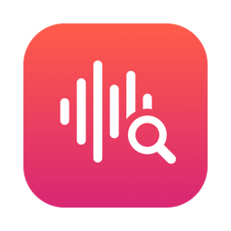
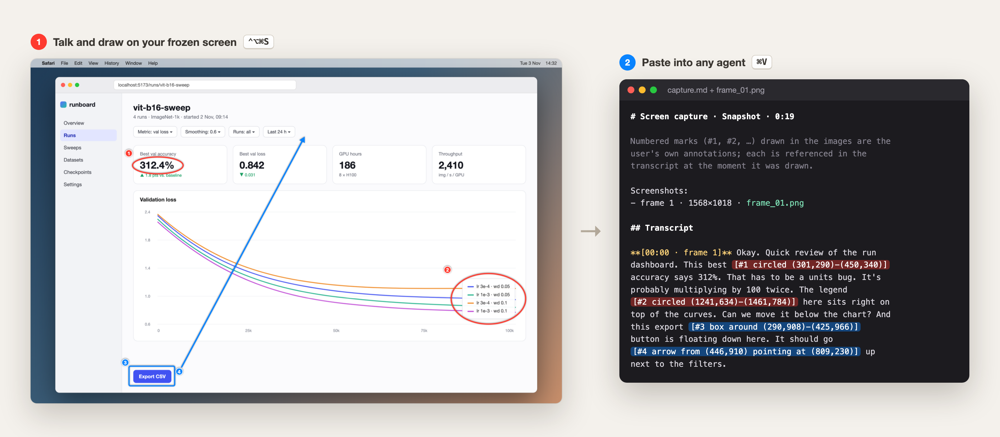
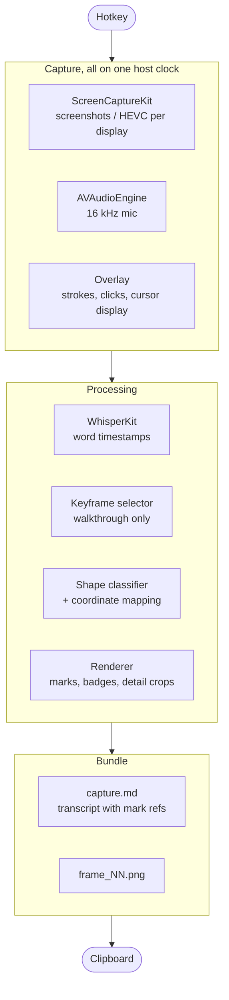

<p align="center"></p>

<h1 align="center">voice-annotate</h1>

<p align="center">
  <b>Talk and draw on your screen, paste the result into any coding agent.</b><br>
  A macOS menu bar app that turns "this thing here is broken" into annotated screenshots and a
  transcript that says exactly which mark you meant, and when. On-device, no API keys.
</p>



## Why

Explaining a UI problem to an agent in text takes longer than fixing it, and a bare
screenshot loses the pointing: *this* number, *that* legend, move *this* button *there*.
voice-annotate records what you say while you draw. Every mark is numbered and burned into
the image. The transcript then cites the mark at the word you were saying when you drew it,
with its location in image pixels:

> This best `[#1 circled (303,290)-(452,340) in frame 1]` accuracy says 312%. That has to be
> a units bug…

The agent gets both what you meant and where it is, and can act on it without a back-and-forth.
The figure above is real output: the screen is a mockup, the voice is macOS text-to-speech, and
everything else is the actual pipeline ([example capture.md](docs/demo/example-capture.md)).

## Features

- **Snapshot** (`⌃⌥⌘S`) freezes every display. You draw and talk over the frozen screen. You
  can hide the overlay, navigate somewhere else and take the next shot without stopping the
  recording.
- **Walkthrough** (`⌃⌥⌘R`) records the screen while you keep working. Hold `⌃⌥` to draw
  laser-pointer marks that fade away. Agents can't watch video, so the recording becomes an
  adaptive keyframe storyboard (up to 30 frames), picked from screen changes, clicks, speech
  and annotations.
- **Smart pen.** Strokes are classified when you let go: a closed loop becomes *circled*,
  a straight stroke an *underline*, and a tap a *pin*. There are also arrow, box, ellipse,
  highlighter and pin tools.
- **Grounded references.** Each mark appears in the transcript as `[#n <shape> <coords> in
  frame k]`, aligned to word-level timestamps.
- **Multi-display.** All displays are captured in parallel. In walkthroughs, the cursor
  position decides which display a keyframe comes from.
- **Detail crops.** On 4K/6K displays, annotated regions also get a native-resolution crop,
  so small text stays readable after downscaling.
- **Pastes anywhere.** One clipboard write works in terminals like Claude Code, which read
  the text and the image paths. It also works in Electron and web chats, which attach the
  images plus `capture.md`. Alternative formats are under *Recent captures*.
- **Fully local.** Transcription runs with [WhisperKit](https://github.com/argmaxinc/WhisperKit)
  (Whisper large-v3 turbo) on the GPU or Neural Engine. Nothing leaves the machine.

## How it works



Some of the design decisions:

- **One clock.** Strokes, clicks, audio samples, SCStream frames and `NSEvent`s are all
  stamped in host time (`mach_absolute_time`). That's what lets a stroke land on the word
  you were saying when you drew it.
- **Storyboard instead of video.** During recording, each frame is shrunk to a 64×40
  luminance thumbnail and diffed against the previous one. Keyframe candidates are frames
  where the screen settles after a change, clicks, the end of an annotation burst, speech
  onsets and a periodic fallback. They are scored and spaced at least 1.2 s apart.
  Annotated frames are always kept, and near-duplicates are dropped.
  [SPEC.md §4](SPEC.md#4-walkthrough--keyframe-storyboard) has the details.
- **Pasteboard pragmatics.** Different apps read a mixed pasteboard differently. Terminals
  take the text, and Electron chats take the files and silently drop the text. So item 0
  carries both the transcript text and a file URL to `capture.md`.
- **Responsive while capturing.** The overlay is a nonactivating `NSPanel` that takes key
  focus without activating the app. The model is preloaded at launch. Auto compute starts on
  a GPU build (about 0.25× real time) while the Neural Engine build (about 0.08×) compiles
  in the background.
- **Testable core.** Shape classification, keyframe selection, transcript interleaving,
  markdown composition and coordinate mapping live in `VoiceAnnotateCore`, a pure Swift
  module with unit tests. The app target holds only the AppKit, ScreenCaptureKit and
  WhisperKit glue.

The full design is in [SPEC.md](SPEC.md).

## Use

| Shortcut | |
|---|---|
| `⌃⌥⌘S` | **Snapshot.** Freezes all displays; draw and talk. `⇥` hides the overlay so you can navigate, `⌃⌥⌘S` takes the next shot, `↩` finishes, `⎋` cancels |
| `⌃⌥⌘R` | **Walkthrough.** Records all displays while you work. Hold `⌃⌥` (or toggle with `⌃⌥⌘D`) to draw; `⌃⌥⌘R` again finishes |
| `⌃⌥⌘F` | Finish any capture |

Snapshot tool keys: `P` smart pen · `A` arrow · `R` box · `O` ellipse · `H` highlighter ·
`N` pin · `1–6` colors · `⌘Z` undo.

Each capture is saved as a bundle in `~/.voice-annotate/captures/<timestamp>/`, containing
`capture.md`, the annotated frames, the audio, the recording and an `events.json` timeline.
Bundles are pruned after 14 days.

## Build

Requires macOS 15+, Xcode 16+ (Swift 6 toolchain) and Apple Silicon.

```bash
make install   # build release, sign with your Apple Development identity, copy to ~/Applications
make run       # install + launch
make test      # unit tests (VoiceAnnotateCore)
```

On first launch, grant **Screen Recording** (then relaunch) and **Microphone**. The Whisper
model (~630 MB) downloads to `~/.voice-annotate/models` on first start.

The binary also has developer commands, e.g. `.build/debug/VoiceAnnotate --help`:
`--transcribe <audio>`, `--render-demo <out.png>`, `--demo-snapshot <audio> [screenshot annotations]`,
`--test-screenshot [screen]`, `--test-walkthrough <seconds> [screen|all]`.
`docs/demo/render.sh` regenerates the README images with the real pipeline.

## Stack

Swift 6 · SwiftUI + AppKit · ScreenCaptureKit · AVFoundation · Core Graphics ·
WhisperKit (Core ML) · SwiftPM

## License

[MIT](LICENSE)
